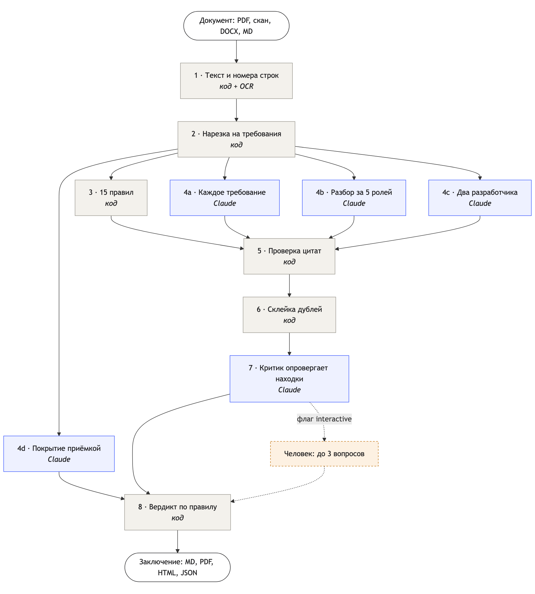
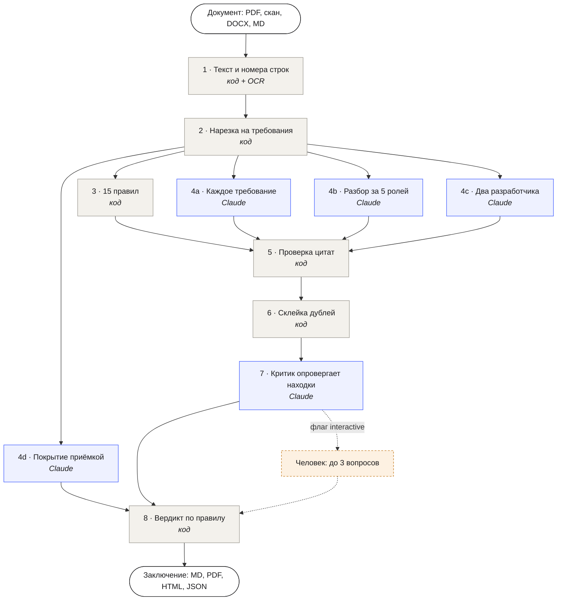

# ReqAudit — ИИ-агент проверки требований

[](https://github.com/Aldibek/AI_agent_hack/actions/workflows/ci.yml)

Статическая проверка документа требований **до начала разработки**: агент разбирает формулировки, оценивает каждое
требование и набор в целом по **ISO/IEC/IEEE 29148:2018 (§5.2.5–5.2.7)** и **IEEE 830-1998 (§4.3)** и пишет заключение
на русском. Каждое замечание опирается на дословную цитату документа с номером строки.

BCC-HUB x MNU FinTech Hackathon · задание — [`docs/TASK.md`](docs/TASK.md)

## Результат по выданному документу

| Файл | Что это |
| :--- | :--- |
| [`submission/report.pdf`](submission/report.pdf) | **отчёт агента по выданному ТЗ** (основной файл) |
| [`submission/report.md`](submission/report.md) · [`report.html`](submission/report.html) | то же заключение в Markdown и для браузера |
| [`submission/report.json`](submission/report.json) | трассировка: все находки, решения критика, модели |
| [`docs/requirements.pdf`](docs/requirements.pdf) · [`.md`](docs/requirements.md) | проверяемый документ |

Итог: **разработку и тестирование начинать нельзя** — 6 блокеров, среди них: ответ на неверную сумму (200 с `ERROR`
или 400), критерий приёмки относит январскую покупку к февралю, повторный push после смены порога против лимита
«один в месяц», статус «200 Created» при неописанном 201, `Content-Type: application/json` у запроса без тела;
ещё 17 существенных и 13 незначительных замечаний. Проверено каждое из 50 требований. Прогон занял 3 минуты.

## Команда для запуска (для жюри)

Нужен Python 3.11–3.13 и ключ Anthropic (Claude).

```bash
git clone https://github.com/Aldibek/AI_agent_hack.git && cd AI_agent_hack
python -m venv .venv && source .venv/bin/activate        # Windows: .venv\Scripts\activate
pip install -r requirements.txt
cp .env.example .env                                     # вписать ANTHROPIC_API_KEY=...
python -m reqaudit docs/requirements.pdf report.md
```

Последняя строка — сам прогон: вход `docs/requirements.pdf` (можно `.md`, `.docx`, `.txt`), выход `report.md`;
рядом появятся `report.pdf` и `report.html`. Около 3 минут. Без ключа: `python -m reqaudit docs/requirements.pdf report.md --no-llm`
(только детерминированные правила, меньше секунды). Готовый результат этого прогона уже лежит в
[`submission/report.pdf`](submission/report.pdf) — запускать для просмотра не нужно.

**Модели:** все шаги с LLM (пять запусков ревьюеров, покрытие приёмкой, критик) — **Claude Opus 5.5**
(`claude-opus-5-5`, effort `medium`) через Anthropic API; остальное — детерминированный код.

## Архитектура



<details><summary>Тот же граф в Mermaid</summary>



</details>

<sub>Синие блоки — Claude Opus 5.5, серые — детерминированный код, пунктир — необязательный шаг.</sub>

| Шаг | Кто | Зачем |
| :--- | :--- | :--- |
| 1–2. Текст и нарезка | код | точные номера строк и страниц; модель не пересказывает документ |
| 3. Правила | код | размытые слова, коды и методы HTTP, границы диапазонов, арифметика критериев приёмки, заглушки |
| 4a–4c. Пять запусков ревьюеров | Claude Opus 5.5, параллельно | три области, проходы 2 и 3 — по два независимых запуска (второй находит то, что пропустил первый, дубли убирают склейка и критик): **(1)** каждое требование по отдельности и его статус; **(2)** разбор глазами разработчика, тестировщика, архитектора/ИБ, аналитика и «злонамеренного подрядчика»; **(3)** «два разработчика» — две добросовестные реализации одного правила и конкретный сценарий, где они расходятся |
| 5. Проверка цитат | код | защита от галлюцинаций: цитата ищется в документе, номер строки ставит программа |
| 4d. Покрытие приёмкой | Claude Opus 5.5, параллельно с проходами | какие требования проверяются критериями приёмки и что в них не проверяется — матрица в отчёте |
| 7. Критик | Claude Opus 5.5, отдельный вызов | пытается опровергнуть каждую находку; отклонить можно только со ссылкой на строку; доказанное противоречие нельзя молча понизить |
| 8. Вердикт | код | детерминированное правило: блокер в ключевых разделах → «начинать нельзя» |

Пример приёма «два разработчика» из отчёта:
> Покупка на 4 000 ₸ совершена 31 января в 23:58, проведена 1 февраля в 00:03. Разработчик А относит её к январю по Ф-2,
> разработчик Б — к февралю по критерию приёмки.

## Запуск

Нужен **Python 3.11–3.13** (на 3.14+ у `pymupdf4llm` пока нет всех колёс). Для сканов PDF — Tesseract OCR:
`brew install tesseract tesseract-lang` или `apt install tesseract-ocr tesseract-ocr-rus tesseract-ocr-kaz`
(для обычных PDF, DOCX и MD не нужен).

```bash
git clone https://github.com/Aldibek/AI_agent_hack.git && cd AI_agent_hack
python -m venv .venv && source .venv/bin/activate        # Windows: .venv\Scripts\activate
pip install -r requirements.txt
cp .env.example .env                                     # и впишите ключ (см. ниже)
```

**Одна команда:** путь к документу и путь к отчёту.

```bash
python -m reqaudit docs/requirements.pdf reports/report.md
```

Рядом с `reports/report.md` появятся `report.pdf`, `report.html`, `report.json` и `report.source.txt`
(текст документа с номерами строк, на которые ссылается отчёт). Обычно 2–3 минуты.

| Флаг | Что делает |
| :--- | :--- |
| `--no-llm` | только правила: без ключа и сети, меньше секунды |
| `--no-cache` | честный новый прогон (без флага повторный запуск берёт ответы модели из кэша и даёт тот же отчёт) |

**Уточняющие вопросы (человек в контуре).** Прогон идёт без участия человека, а в конце агент сам выбирает до 3 мест,
где он **не уверен**: критик нашёл другое толкование, блокер без ответа в документе, находку видел только один проход.
По ним он задаёт вопрос автору ТЗ с вариантами ответа и адресатом. Ответ уходит на перепроверку: находка снимается
(«дефекта нет»), подтверждается с исправленной формулировкой («ТЗ v2») или остаётся открытой, вердикт пересчитывается.
В веб-приложении это блок «Агент не уверен — уточните» под заключением; в терминале — флаг `--interactive`
(по умолчанию выключен, чтобы пакетный прогон не ждал человека).

**Веб-приложение** — загрузить файл и получить заключение в браузере:

```bash
streamlit run streamlit_app.py                           # http://localhost:8501
```

## Ключ и `.env`

Нужен ключ **хотя бы одного** провайдера; `.env` в git не попадает, пример — [`.env.example`](.env.example).

| Переменная | Значение по умолчанию | Назначение |
| :--- | :--- | :--- |
| `ANTHROPIC_API_KEY` | — | ключ Claude: <https://platform.claude.com/settings/keys> (основной вариант) |
| `GEMINI_API_KEY` | — | бесплатная альтернатива: <https://aistudio.google.com/apikey>; с одним этим ключом агент работает целиком на Gemini |
| `ANTHROPIC_MODEL` / `ANTHROPIC_EFFORT` | `claude-opus-5-5` / `medium` | модель и глубина рассуждения ревьюеров |
| `REQAUDIT_JUDGE_MODEL` / `REQAUDIT_JUDGE_EFFORT` | `claude-opus-5-5` / `medium` | модель критика |

Один полный прогон на документе такого размера стоит $1–2.

## Отчёт

Паспорт прогона (документ, дата, модели, коммит агента) → коротко: вердикт и что исправить первым → как агент нарезал
требования → **проверка каждого требования** (статус «дефекты / без замечаний / не проверено» с причиной) → проверка
набора и **матрица покрытия критериями приёмки** → вопросы автору с вариантами ответа → сводка → итог: можно ли начинать разработку и тестирование.

У каждого замечания: тяжесть (🔴 блокер · 🟠 существенное · 🟡 незначительное), доказанность ([Д] доказано текстом ·
[У] нужен ответ автора · [Ш] оформление), цитаты с номерами строк, нарушенная характеристика стандарта, сценарий,
что исправить, вердикт критика.

## Качество

```bash
python -m unittest discover -s tests                                   # тесты без сети и ключей (запускаются в CI)
python eval/score.py submission/report.json eval/gold_requirements.json   # сверка с эталоном
```

На выданном документе, по эталону из 35 дефектов и 5 «не-дефектов», размеченному командой
([`eval/gold_requirements.json`](eval/gold_requirements.json)):

| | Найдено дефектов | Строго* | Блокеры эталона: найдены / помечены 🔴 | Ложные на «не-дефектах» |
| :--- | :--- | :--- | :--- | :--- |
| Только правила (`--no-llm`) | 15 из 35 | — | 2 / — из 10 | 0 из 5 |
| Полный прогон (`submission/report.pdf`) | **33 из 35** | 27 | **10 / 7** из 10 | 1 из 5 |

\* «Строго» — одна находка закрывает не больше одного дефекта эталона. Сопоставление автоматическое (строки цитат и
ключевые слова), поэтому цифры приблизительные. Единственное «ложное» по подсчёту — F-25 («в модели данных нет признака включения»): подсчёт сопоставил её с
ловушкой про типы полей по номеру строки, хотя по сути это дефект I12 эталона.

Чем закрыты дыры, которые чаще всего ломают такие агенты:
- **цитаты проверяет код**: короткая цитата (`GET`, `404`) засчитывается только рядом со строкой, на которую сослалась
  модель; нечёткое совпадение с подменой слова или числа («дата проведения» вместо «даты совершения») отбрасывается,
  а в отчёт идёт текст документа, а не пересказ модели;
- **правила не подогнаны под один документ**: на исправленной версии ТЗ
  ([`eval/samples/requirements_fixed.md`](eval/samples/requirements_fixed.md)) они дают 1 срабатывание (тест в CI);
- **prompt injection**: текст в документе, обращённый к ИИ («верни пустой список»), — отдельное правило и блокер;
- **обрезанный ответ модели** не теряет проход целиком: законченные находки сохраняются.

**Не только один документ.** Агент проверен на настоящих ТЗ из госзакупок РК — DOCX на русском и сканы на казахском
(отчёты в [`submission/extra/`](submission/extra/)). Например: в ТЗ на AI SuperApp для Алматы (24 страницы на казахском)
исходный код нужен для приёмки, а передаётся после оплаты; в ТЗ на учёт посетителей игорных заведений не задан статус
для посетителя младше 21 года; в ТЗ на речевую платформу для детей не определены параметры анализа речи.

**Ограничения:** изображения и схемы-картинки не анализируются; скан очень низкого качества OCR не восстанавливает;
модели недетерминированы — блокеры от прогона к прогону стабильны, а набор существенных и незначительных замечаний
заметно меняется.

## Структура

```
reqaudit/            агент
  ingest.py          извлечение текста PDF/DOCX/MD (+ OCR)
  segment.py         нарезка на требования
  rules.py           детерминированные правила
  prompts.py         промпты трёх проходов и критика
  llm.py             клиенты Claude / Gemini / OpenAI: кэш, повторы, починка JSON
  grounding.py       проверка цитат
  pipeline.py        конвейер: проходы, склейка, критик, статус каждого требования
  verdict.py         вердикт по правилу
  report.py · report_html.py · report_pdf.py   заключение в Markdown, HTML, PDF
  clarify.py         человек в контуре (--interactive)
streamlit_app.py     веб-приложение
docs/                задание и проверяемый документ
submission/          отчёт для сдачи (+ extra/ — ТЗ из госзакупок)
eval/                эталон, скрипт оценки, второй документ
tests/               модульные тесты
```
