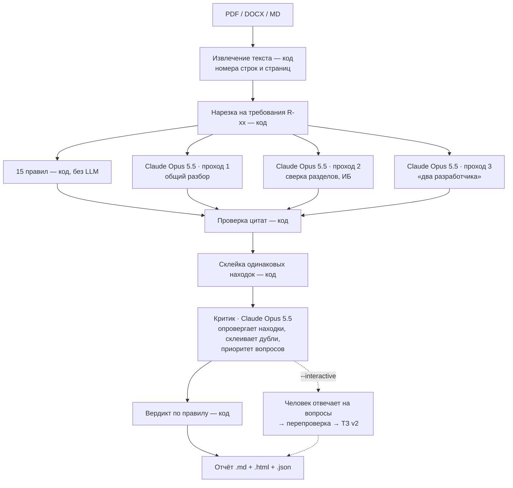

# ReqAudit — агент проверки требований

ИИ-агент для **статической проверки документа требований** до разработки: разбирает формулировки, оценивает каждое
требование и набор в целом по **ISO/IEC/IEEE 29148:2018 (§5.2.5–5.2.7)** и **IEEE 830-1998 (§4.3)** и пишет отчёт на русском.

BCC-HUB x MNU FinTech Hackathon · задание: [BCC-HUB/ai-requirements-validator-task](https://github.com/BCC-HUB/ai-requirements-validator-task)
(копия — [`docs/TASK.md`](docs/TASK.md)).

## Как работает



- **Текст извлекает код, а не модель**: номера строк и страниц точные.
- **Три прохода Claude параллельно**, каждый смотрит за 5 ролей: разработчик, тестировщик, архитектор/ИБ, аналитик и
  **злонамеренный подрядчик** (ищет, как выполнить ТЗ «по букве» и сдать плохую систему).
- **«Два разработчика»**: модель реализует правило двумя добросовестными способами и показывает сценарий, где результаты
  расходятся. Это доказательство неоднозначности, а не мнение модели:
  > Покупка на 4 000 ₸ совершена 31 января в 23:58 и проведена 1 февраля в 00:03. Разработчик А увеличивает январский
  > итог, разработчик Б — февральский.
- **Проверка цитат кодом**: находка без дословной цитаты из документа удаляется, номер строки ставит программа.
- **Критик** — отдельный вызов, который пытается опровергнуть каждую находку: отклонить можно только со ссылкой на
  строку документа, а доказанное противоречие нельзя понизить, только отклонить с обоснованием.
- **Вердикт по правилу**: есть блокер в ключевых разделах → разработку начинать нельзя.

## Установка

Нужен Python 3.11+ (этого требует `pymupdf4llm`, через который читается PDF).

```bash
git clone https://github.com/Aldibek/AI_agent_hack.git && cd AI_agent_hack
python -m venv .venv && source .venv/bin/activate      # Windows: .venv\Scripts\activate
pip install -r requirements.txt
cp .env.example .env
```

## Ключ LLM

Откройте `.env` и укажите ключ **хотя бы одного** провайдера (файл `.env` в git не попадает):

| Провайдер | Где взять ключ | Переменная |
| :--- | :--- | :--- |
| **Anthropic Claude** — основной | <https://platform.claude.com/settings/keys> | `ANTHROPIC_API_KEY` |
| Google Gemini — бесплатно | <https://aistudio.google.com/apikey> | `GEMINI_API_KEY` |
| OpenAI — по желанию | <https://platform.openai.com/api-keys> | `OPENAI_API_KEY` |

С одним ключом Gemini агент работает целиком на Gemini (без оплаты).

**Модели команды для сдачи:**

| Роль | Модель |
| :--- | :--- |
| Ревьюер, 3 прохода | Claude Opus 5.5 (`claude-opus-5-5`), effort `medium` |
| Критик (судья) | Claude Opus 5.5, effort `medium` — отдельный вызов с задачей опровергнуть каждую находку |

## Запуск (одна команда)

```bash
python -m reqaudit <путь к файлу требований> <путь к файлу отчёта>

python -m reqaudit docs/requirements.pdf reports/report.md
```

Результаты:
- `reports/report.md` — **отчёт** на русском;
- `reports/report.html` — заключение для чтения в браузере (с кнопками скачивания MD / PDF / HTML);
- `reports/report.pdf` — то же заключение в PDF;
- `reports/report.json` — трассировка: все находки, отклонённые критиком, модели, вызовы, расходы;
- `reports/report.source.txt` — текст документа с номерами строк, на которые ссылается отчёт.

| Флаг | Что делает |
| :--- | :--- |
| `--no-llm` | только правила, без ключа и сети (< 1 с) |
| `--interactive` | **человек в контуре**: агент задаёт до 3 вопросов (`REQAUDIT_QUESTIONS`) только там, где сам не уверен — критик нашёл другое толкование, в документе нет ответа на блокирующий вопрос, находку видел один проход. Ответ автора снимает неопределённость: находка либо подтверждается и получает исправленную формулировку (ТЗ v2), либо снимается |
| `--no-cache` | честный новый прогон; без флага повторный прогон берёт ответы моделей из `.reqaudit_cache/` и даёт тот же отчёт |
| `--force-budget` | начать, даже если оценка стоимости выше лимита |

### Веб-приложение

```bash
streamlit run streamlit_app.py      # откроется http://localhost:8501
```

Загрузите PDF (в том числе скан), DOCX, MD или TXT → «Проверить» → заключение прямо на странице и кнопки
**Markdown · PDF · HTML · JSON**. Вкладка «Пример» мгновенно показывает готовое заключение по документу хакатона.
Режим «Быстрая» — только правила, без ключа и бесплатно.

**Публикация в Streamlit Community Cloud** (чтобы дать жюри ссылку): share.streamlit.io → New app → этот репозиторий,
файл `streamlit_app.py`, Python 3.11+. В *Settings → Secrets*:

```toml
ANTHROPIC_API_KEY = "sk-ant-..."
APP_PASSWORD = "код-для-жюри"   # полная (платная) проверка только по коду; быстрая — всем
REQAUDIT_DAILY_BUDGET_USD = "10"
```

Системные пакеты для распознавания сканов (`tesseract-ocr`, языки rus/kaz) перечислены в `packages.txt`.

## Состав отчёта

1. Паспорт прогона: документ, дата, модели, версия агента (коммит), режим, стоимость.
2. Как агент нарезал требования: «ID в отчёте — ID в документе — где — краткая формулировка».
3. Проверка каждого требования: матрица характеристик 29148 / IEEE 830 и замечания с цитатами.
4. Проверка всего набора: полнота, непротиворечивость, понятность, трассируемость и т.д.
5. Уточняющие вопросы к автору: по приоритету, с вариантами ответа и адресатом.
6. Сводка: число требований и нарушений, критичные дефекты.
7. Итог: можно ли начинать разработку и тестирование, что исправить в первую очередь.
8. Покрытие и ограничения прогона.

У каждого замечания: тяжесть (🔴 блокер / 🟠 существенный / 🟡 незначительный), доказанность ([Д] доказано текстом /
[У] вопрос автору / [Ш] шаблон), цитаты с номерами строк, нарушенная характеристика стандарта, сценарий, что сделать,
кто нашёл и вердикт критика.

## Контроль расходов

- Каждый вызов LLM пишется в журнал `.reqaudit_costs/ledger.jsonl`: модель, роль, токены, стоимость, время.
- **Лимиты:** `REQAUDIT_BUDGET_USD` — на прогон (по умолчанию $2), `REQAUDIT_DAILY_BUDGET_USD` — за сутки ($15).
  Перед стартом печатается оценка стоимости; вызов, который не помещается в остаток, пропускается, остальные шаги
  выполняются. При 80% лимита и при прогоне дороже 2× обычного — предупреждение.
- Стоимость прогона — в паспорте отчёта и в `report.json`.
- Сводка по дням, моделям и ролям: `python -m reqaudit.costs --days 7`.

## Проверка качества

```bash
python -m unittest discover -s tests -v                                 # тесты, без сети и ключей
python eval/score.py reports/report.json eval/gold_requirements.json    # сверка с эталоном
```

`eval/gold_requirements.json` — размеченный вручную эталон проблем выданного документа: 35 дефектов и 5 «не-дефектов»,
на которых агент должен промолчать. В промпты не попадает. Сопоставление автоматическое (по строкам цитат и ключевым
словам), поэтому оценка приблизительная.

| Режим (на `docs/requirements.md`) | Найдено эталонных дефектов: мягко / строго* | Блокеры | Ложные на «не-дефектах» | Время | Стоимость |
| :--- | :--- | :--- | :--- | :--- | :--- |
| Только правила (`--no-llm`) | 16 / — из 35 | 2 из 10 | 0 из 5 | < 1 с | $0 |
| **Полный, Claude Opus 5.5 — отчёт в `submission/`** | **33 / 27 из 35** | **10 из 10** | **0 из 5** | **2,8 мин** | **$1.03** |

\* «Строго» — каждая находка агента закрывает не больше одного дефекта эталона; «мягко» — как в ранних замерах.
Эталон составила команда, сопоставление автоматическое (строки цитат и ключевые слова), поэтому цифры приблизительные:
часть «пропусков» — это находки, которые критик отклонил со ссылкой на строку документа (например, «часовой пояс
задан городом» — «в Алматы» однозначно задаёт пояс), и мы считаем такое решение спорным, а не ошибкой агента.
Разброс — по нескольким прогонам: модели недетерминированы.

### Проверка на настоящих ТЗ из госзакупок (goszakup.gov.kz)

Чтобы убедиться, что агент не подогнан под один документ, он прогнан на технических спецификациях из открытых
госзакупок РК — другой шаблон, другой язык, сканы. Режим экономный: ревьюер Claude Sonnet 5.5, 2 прохода, effort `low`,
лимит $0.50 на документ. Отчёты — в [`submission/extra/`](submission/extra/).

| Документ | Формат | Требований | Замечаний (блокеры) | Время | Стоимость | Пример находки |
| :--- | :--- | :--- | :--- | :--- | :--- | :--- |
| [Система проверки допуска к азартным играм](https://goszakup.gov.kz/ru/announce/index/17983827?tab=documents) | DOCX, рус. | 28 | 23 (1) | 89 с | $0.48 | нет приоритета статусов при частичных результатах проверки по реестрам |
| [AI SuperApp г. Алматы](https://goszakup.gov.kz/ru/announce/index/17731300?tab=documents) | PDF-скан, 24 стр., **каз.** | 169 | 22 (6) | 112 с | $0.47 | срок 25 дней на весь SuperApp; исходный код передаётся только после оплаты, а оплата — после акта |
| [ИИ-платформа для дошкольников](https://goszakup.gov.kz/ru/announce/index/17603368?tab=documents) | PDF-скан, **каз.** | 48 | 12 (0) | 81 с | $0.26 | «Android и при необходимости iOS и веб» — состав платформ не определён |

Сканы распознаются Tesseract (`rus+kaz+eng`), отчёт по казахскому документу — на русском с цитатами из оригинала.
Ограничение: четвёртый документ ([нейротренинговая платформа](https://goszakup.gov.kz/ru/announce/index/17641126?tab=documents))
— скан низкого качества со встроенным «битым» текстовым слоем; OCR его не восстанавливает, для таких файлов нужна
модель, читающая изображение страницы. В двух прогонах критик пропущен по лимиту $0.50 — это видно в паспорте отчёта. `eval/samples/` — документ другого стиля (16 требований,
сценарии Дано/Когда/Тогда) для проверки, что агент работает не только на одном файле.

## Структура

```
reqaudit/
  ingest.py      извлечение текста PDF/DOCX/MD с номерами строк и страниц
  segment.py     нарезка на требования
  rules.py       детерминированные проверки
  llm.py         клиенты LLM: Claude (SDK anthropic), Gemini и OpenAI; кэш, повторы, починка JSON
  prompts.py     промпты ревьюера (5 ролей) и критика
  grounding.py   проверка цитат
  pipeline.py    конвейер: консилиум, проверка цитат, склейка, критик
  clarify.py     человек в контуре (--interactive)
  verdict.py     вердикт по правилу
  costs.py       учёт расходов и лимиты; python -m reqaudit.costs
  report_pdf.py  PDF-версия заключения (PyMuPDF, без браузера)
  report.py      отчёт Markdown и трассировка
  report_html.py наглядный HTML-отчёт
streamlit_app.py веб-приложение: загрузить документ → заключение → скачать
docs/            задание хакатона и проверяемый документ (requirements.md / .pdf)
eval/            эталон, скрипт оценки, второй документ
submission/      отчёт для сдачи
tests/           модульные тесты
```
