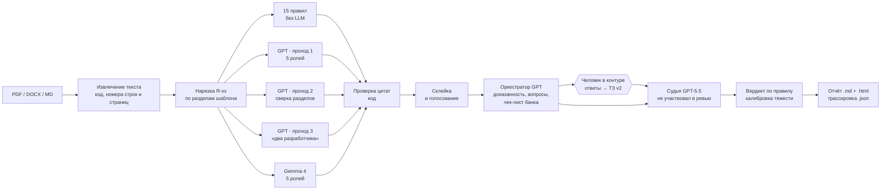

# ReqAudit — агент проверки требований

ИИ-агент для **статической проверки документа требований** до разработки: разбирает формулировки, оценивает каждое
требование и набор в целом по **ISO/IEC/IEEE 29148:2018 (§5.2.5–5.2.7)** и **IEEE 830-1998 (§4.3)** и пишет отчёт на русском.

BCC-HUB x MNU FinTech Hackathon · задание: [BCC-HUB/ai-requirements-validator-task](https://github.com/BCC-HUB/ai-requirements-validator-task)

## Что делает

- читает **PDF**, DOCX, Markdown, TXT; номера строк и страниц сохраняются;
- **нарезает** документ на требования: свои идентификаторы R-xx, ID из документа, цитата, место;
- **детерминированные правила** без LLM: заглушки шаблона, размытые слова, семантика HTTP, коды ответов, единицы сумм,
  часовой пояс, границы диапазонов и их покрытие критериями приёмки, арифметика критериев приёмки, ссылки на документы;
- **консилиум LLM:** 1–3 модели разных компаний (или 2 прохода одной модели) параллельно проверяют документ за 5 ролей —
  разработчик, тестировщик, архитектор/ИБ, бизнес-аналитик, **злонамеренный подрядчик** (ищет лазейки «по букве ТЗ»);
- **проверка цитат кодом:** находка без дословной цитаты из документа удаляется, номер строки ставит программа;
- **склейка и голосование** находок, **оркестратор** формулирует итог и **уточняющие вопросы** с вариантами ответа,
  **независимый судья** отсеивает ложные срабатывания;
- **вердикт по правилу:** можно ли начинать разработку и тестирование и что исправить в первую очередь;
- **человек в контуре** (опционально): ответы на вопросы → перепроверка → исправленные формулировки (ТЗ v2).



Роли ревьюера (Perspective-Based Reading): разработчик, тестировщик, архитектор/ИБ, бизнес-аналитик,
**злонамеренный подрядчик** — ищет, как формально выполнить ТЗ «по букве» и сдать плохую систему.

Проход **«два разработчика»**: модель «реализует» правило двумя добросовестными способами и показывает конкретный сценарий,
где результаты расходятся, — это доказательство неоднозначности или противоречия, а не мнение модели. Пример из отчёта:

> Сценарий: покупка на 4 000 ₸ совершена 31 января в 23:58 и проведена 1 февраля в 00:03. Разработчик А: увеличивает
> январский итог. Разработчик Б: увеличивает февральский итог.

## Установка

Нужен Python 3.10+.

```bash
git clone <этот репозиторий> && cd reqaudit
python -m venv .venv && source .venv/bin/activate      # Windows: .venv\Scripts\activate
pip install -r requirements.txt
```

## Ключ LLM

1. Получите ключ хотя бы одного провайдера:
   - **OpenAI**: <https://platform.openai.com/api-keys> → `OPENAI_API_KEY`;
   - **AlemLLM** (alem.ai, казахстанская модель): ключ из личного кабинета alem.ai → `ALEM_API_KEY`
     (для `gemma4` на alem.ai — отдельный ключ → `GEMMA_API_KEY`);
   - **Google Gemini**, бесплатно: <https://aistudio.google.com/apikey> → *Create API key* → `GEMINI_API_KEY`;
   - по желанию **Groq** (<https://console.groq.com/keys>) или **OpenRouter** — это дополнительные ревьюеры других компаний.
2. Скопируйте пример конфига и вставьте ключ:
   ```bash
   cp .env.example .env
   # откройте .env и заполните, например, GEMINI_API_KEY=... и/или ALEM_API_KEY=...
   ```
   Файл `.env` в репозиторий не попадает (он в `.gitignore`).

**Модели команды для сдачи:**

| Роль | Модель |
| :--- | :--- |
| Ревьюер 1 (основной), 3 прохода: общий · сверка разделов/терминология/ИБ · «два разработчика» | OpenAI `gpt-6.2-sol` |
| Ревьюер 2 | AlemLLM `alemllm` (alem.ai, Казахстан) |
| Ревьюер 3 | Google Gemma `gemma4` (через alem.ai) |
| Оркестратор (главный) | OpenAI `gpt-6.2-sol` |
| Судья | OpenAI `gpt-5.5` — другая модель, в ревью не участвовала |

Имена моделей и роли задаются в `.env` (`OPENAI_MODEL`, `ALEM_MODEL`, `REQAUDIT_REVIEWERS`, `REQAUDIT_JUDGE_MODEL`, …).
**Достаточно одного любого ключа:** тогда агент делает 2 независимых прохода одной модели. Каждый дополнительный ключ
добавляет ревьюера другой компании. Медленный ревьюер ограничен бюджетом времени (`REQAUDIT_REVIEW_DEADLINE`): если он
не успел, прогон продолжается без него, а в паспорте отчёта ставится пометка.

## Запуск (одна команда)

```bash
python -m reqaudit <путь к файлу требований> <путь к файлу отчёта>
```

Пример:

```bash
python -m reqaudit ../ai-requirements-validator-task/docs/requirements.pdf reports/report.md
```

Куда ложатся результаты:
- `reports/report.md` — **отчёт** на русском;
- `reports/report.html` — наглядная версия: документ с подсветкой проблемных строк по тяжести и карточки замечаний
  с фильтрами (клик по строке → замечание, клик по цитате → строка документа);
- `reports/report.json` — трассировка: все находки, отброшенные и отклонённые судьёй, модели, вызовы;
- `reports/report.source.txt` — текст документа с номерами строк, на которые ссылается отчёт (для PDF).

Дополнительные режимы:

| Флаг | Что делает |
| :--- | :--- |
| `--no-llm` | только детерминированные правила, без ключа и сети |
| `--interactive` | задаёт главные уточняющие вопросы в терминале, перепроверяет и предлагает исправленные формулировки |
| `--answers answers.json` | то же по сохранённым ответам: `{"F-01": "по дате совершения"}` |
| `--reviewers alem,gemini` · `--judge groq` | явный выбор ролей |
| `--no-cache` | не использовать кэш ответов LLM (по умолчанию повторный прогон берёт ответы из `.reqaudit_cache/`) |

### Сценарий демо

```bash
# 1) мгновенно, без ключа: только правила
python -m reqaudit ../ai-requirements-validator-task/docs/requirements.md reports/rules.md --no-llm
# 2) полный прогон: консилиум, оркестратор, судья (~7 мин; повторный запуск берёт ответы из кэша)
python -m reqaudit ../ai-requirements-validator-task/docs/requirements.md reports/report.md
# 3) человек в контуре: ответить на главные вопросы и получить исправленные формулировки (ТЗ v2)
python -m reqaudit ../ai-requirements-validator-task/docs/requirements.md reports/report.md --interactive
```

Повторяемость: при `temperature=0` и одинаковом входе повторный прогон берёт ответы моделей из кэша
(`.reqaudit_cache/`) и даёт идентичный отчёт; `--no-cache` — честный новый прогон. Тяжесть подтверждённых противоречий
в ФТ калибруется правилом, поэтому вердикт не «плавает» между прогонами.

## Состав отчёта

1. Паспорт прогона: документ, дата, модели, версия агента (коммит), вызовы LLM.
2. Как агент нарезал требования: «ID в отчёте — ID в документе — где — краткая формулировка».
3. Проверка каждого требования: матрица характеристик 29148 и замечания с цитатами.
4. Проверка всего набора: полнота, непротиворечивость, понятность, трассируемость и т.д.
5. Уточняющие вопросы к автору: приоритизированы, с вариантами ответа, по адресатам.
6. Черновик заполнения чек-листа ревью из шаблона документа (если он есть).
7. Сводка: число требований, нарушений, критичные дефекты.
8. Итог: можно ли начинать разработку и тестирование, что исправить в первую очередь.
9. Покрытие и ограничения прогона.

У каждого замечания: тип, тяжесть (🔴 блокер / 🟠 существенный / 🟡 незначительный), **доказанность** ([Д] доказано текстом /
[У] вопрос автору / [Ш] шаблон), цитаты с номерами строк, нарушенная характеристика стандарта, сценарий-контрпример,
последствия, что сделать, вопрос автору, кто нашёл (голоса) и вердикт судьи.

## Проверка качества агента

```bash
python -m unittest discover -s tests -v                     # тесты детерминированной части
python eval/score.py reports/report.json eval/gold_requirements.json   # сверка отчёта с эталоном
```

**Результаты на выданном документе** (`docs/requirements.md`, 53 требования; сопоставление с эталоном автоматическое —
по строкам цитат и ключевым словам, поэтому оценка приблизительная):

| Режим | Найдено эталонных проблем | Блокеры | Ложные срабатывания на «не-дефектах» | Время |
| :--- | :--- | :--- | :--- | :--- |
| Только правила (`--no-llm`) | 16 из 35 (46%) | 2 из 10 | 0 из 5 | < 1 с |
| Полный: GPT + Gemma, оркестратор GPT, судья GPT-5.5 | 35 из 35 | 10 из 10 | 0 из 5 | ~7–8 мин |
| Полный, вход — **PDF** того же документа | 33 из 35 | 10 из 10 | 0 из 5 | ~7,5 мин |

Судья отсеивает ложные срабатывания ревьюеров: в одном из прогонов он отклонил находку Gemma «404 для чужой карты —
раскрытие существования карты» (это допустимая практика сокрытия ресурса), в другом — две надуманные «неполноты».
Все отклонённые находки сохраняются в `report.json` с обоснованием судьи.

`eval/gold_requirements.json` — вручную размеченный эталон проблем выданного документа (35 дефектов и 5 «не-дефектов»,
на которых агент должен промолчать). Эталон используется только для замеров и в промпты не попадает.
`eval/samples/` — документ другого стиля для проверки устойчивости нарезки и правил. На нём (16 требований, другая
нумерация, сценарии Дано/Когда/Тогда) полный прогон находит заложенное противоречие «SMS при сумме свыше 300 000» ↔
«350 000 — без SMS» как блокер [Д], GET для создания перевода, размытые формулировки и пробелы в бизнес-правилах (~6 мин).

## Структура

```
reqaudit/
  ingest.py      извлечение текста PDF/DOCX/MD с номерами строк
  segment.py     нарезка на требования
  rules.py       детерминированные проверки
  llm.py         клиент OpenAI-совместимых API (Alem, Gemini, Groq, OpenRouter, OpenAI, Ollama), повторы, кэш
  prompts.py     промпты ревьюера (5 ролей), оркестратора, судьи
  grounding.py   проверка цитат
  pipeline.py    конвейер: консилиум, склейка, голосование, оркестратор, судья
  clarify.py     человек в контуре: вопросы → ответы → ТЗ v2
  verdict.py     вердикт по правилу
  report.py      отчёт Markdown и трассировка
  report_html.py наглядный HTML-отчёт с подсветкой
eval/            эталон, скрипт оценки, документ для проверки устойчивости
tests/           модульные тесты
```
