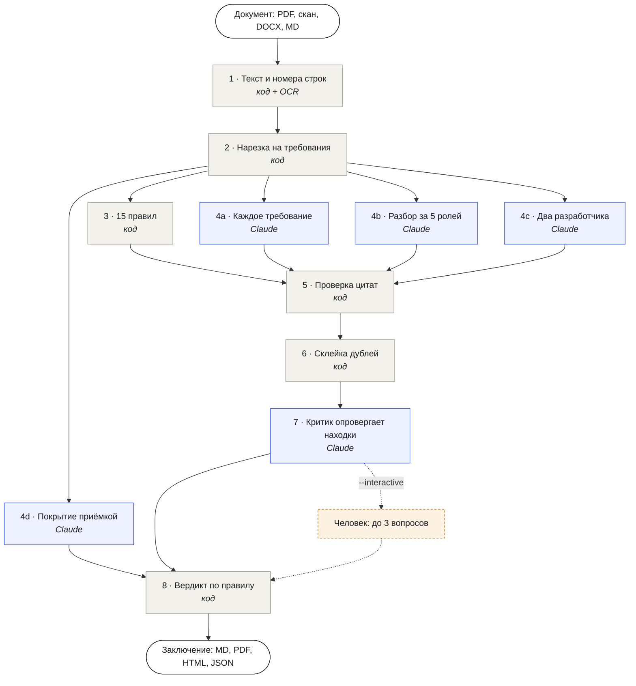

# ReqAudit — ИИ-агент проверки требований

[](https://github.com/Aldibek/AI_agent_hack/actions/workflows/ci.yml)

Статическая проверка документа требований **до начала разработки**: агент разбирает формулировки, оценивает каждое
требование и набор в целом по **ISO/IEC/IEEE 29148:2018 (§5.2.5–5.2.7)** и **IEEE 830-1998 (§4.3)** и пишет заключение
на русском. Каждое замечание опирается на дословную цитату документа с номером строки.

BCC-HUB x MNU FinTech Hackathon · задание — [`docs/TASK.md`](docs/TASK.md)

## Результат по выданному документу

| Файл | Что это |
| :--- | :--- |
| [`submission/report.md`](submission/report.md) | **отчёт агента** (основной файл) |
| [`submission/report.pdf`](submission/report.pdf) · [`report.html`](submission/report.html) | то же заключение в PDF и для браузера |
| [`submission/report.json`](submission/report.json) | трассировка: все находки, решения критика, модели |
| [`docs/requirements.md`](docs/requirements.md) · [`.pdf`](docs/requirements.pdf) | проверяемый документ |

Итог: **разработку начинать нельзя** — 3 блокера (месяц покупки по дате совершения против критерия приёмки;
«один push в месяц» против push после смены порога; нет метода чтения настроек), 9 существенных и 25 незначительных
замечаний, проверено каждое из 53 требований; критериями приёмки покрыто 5 из 49 требований. Прогон занял 3 минуты.

## Архитектура



<sub>Синие блоки — Claude Opus 5.5, серые — детерминированный код, пунктир — необязательный шаг.</sub>

| Шаг | Кто | Зачем |
| :--- | :--- | :--- |
| 1–2. Текст и нарезка | код | точные номера строк и страниц; модель не пересказывает документ |
| 3. Правила | код | размытые слова, коды и методы HTTP, границы диапазонов, арифметика критериев приёмки, заглушки |
| 4a–4c. Три прохода | Claude Opus 5.5, параллельно | у каждого своя область: **(1)** каждое требование по отдельности и его статус; **(2)** разбор глазами разработчика, тестировщика, архитектора/ИБ, аналитика и «злонамеренного подрядчика»; **(3)** «два разработчика» — две добросовестные реализации одного правила и конкретный сценарий, где они расходятся |
| 5. Проверка цитат | код | защита от галлюцинаций: цитата ищется в документе, номер строки ставит программа |
| 4d. Покрытие приёмкой | Claude Opus 5.5, параллельно с проходами | какие требования проверяются критериями приёмки и что в них не проверяется — матрица в отчёте |
| 7. Критик | Claude Opus 5.5, отдельный вызов | пытается опровергнуть каждую находку; отклонить можно только со ссылкой на строку; доказанное противоречие нельзя молча понизить |
| 8. Вердикт | код | детерминированное правило: блокер в ключевых разделах → «начинать нельзя» |

Пример приёма «два разработчика» из отчёта:
> Покупка на 4 000 ₸ совершена 31 января в 23:58, проведена 1 февраля в 00:03. Разработчик А относит её к январю по Ф-2,
> разработчик Б — к февралю по критерию приёмки.

## Запуск

Нужен **Python 3.11+**.

```bash
git clone https://github.com/Aldibek/AI_agent_hack.git && cd AI_agent_hack
python -m venv .venv && source .venv/bin/activate        # Windows: .venv\Scripts\activate
pip install -r requirements.txt
cp .env.example .env                                     # и впишите ключ (см. ниже)
```

**Одна команда:** путь к документу и путь к отчёту.

```bash
python -m reqaudit docs/requirements.pdf reports/report.md
```

Рядом с `reports/report.md` появятся `report.pdf`, `report.html`, `report.json` и `report.source.txt`
(текст документа с номерами строк, на которые ссылается отчёт). Обычно 2–3 минуты.

| Флаг | Что делает |
| :--- | :--- |
| `--no-llm` | только правила: без ключа и сети, меньше секунды |
| `--no-cache` | честный новый прогон (без флага повторный запуск берёт ответы модели из кэша и даёт тот же отчёт) |

**Человек в контуре** есть, но по умолчанию выключен: прогон идёт без участия человека. С флагом `--interactive`
агент задаёт до 3 вопросов там, где сам не уверен (критик нашёл другое толкование, в документе нет ответа на
блокирующий вопрос); ответ автора подтверждает находку с исправленной формулировкой или снимает её.

**Веб-приложение** — загрузить файл и получить заключение в браузере:

```bash
streamlit run streamlit_app.py                           # http://localhost:8501
```

## Ключ и `.env`

Нужен ключ **хотя бы одного** провайдера; `.env` в git не попадает, пример — [`.env.example`](.env.example).

| Переменная | Значение по умолчанию | Назначение |
| :--- | :--- | :--- |
| `ANTHROPIC_API_KEY` | — | ключ Claude: <https://platform.claude.com/settings/keys> (основной вариант) |
| `GEMINI_API_KEY` | — | бесплатная альтернатива: <https://aistudio.google.com/apikey>; с одним этим ключом агент работает целиком на Gemini |
| `ANTHROPIC_MODEL` / `ANTHROPIC_EFFORT` | `claude-opus-5-5` / `medium` | модель и глубина рассуждения ревьюеров |
| `REQAUDIT_JUDGE_MODEL` / `REQAUDIT_JUDGE_EFFORT` | `claude-opus-5-5` / `medium` | модель критика |

Один полный прогон на документе такого размера стоит $1–2.

## Отчёт

Паспорт прогона (документ, дата, модели, коммит агента) → коротко: вердикт и что исправить первым → как агент нарезал
требования → **проверка каждого требования** (статус «дефекты / без замечаний / не проверено» с причиной) → проверка
набора и **матрица покрытия критериями приёмки** → вопросы автору с вариантами ответа → сводка → итог: можно ли начинать разработку и тестирование.

У каждого замечания: тяжесть (🔴 блокер · 🟠 существенное · 🟡 незначительное), доказанность ([Д] доказано текстом ·
[У] нужен ответ автора · [Ш] оформление), цитаты с номерами строк, нарушенная характеристика стандарта, сценарий,
что исправить, вердикт критика.

## Качество

```bash
python -m unittest discover -s tests                                   # тесты без сети и ключей (запускаются в CI)
python eval/score.py submission/report.json eval/gold_requirements.json   # сверка с эталоном
```

На выданном документе, по эталону из 35 дефектов и 5 «не-дефектов», размеченному командой:

| | Найдено дефектов | Блокеры | Ложные на «не-дефектах» |
| :--- | :--- | :--- | :--- |
| Только правила (`--no-llm`) | 16 из 35 | 2 из 10 | 0 из 5 |
| Полный прогон (отчёт в `submission/`) | **31 из 35** (строго — 25*) | **10 из 10** | **0 из 5** |

\* «Строго» — одна находка закрывает не больше одного дефекта эталона. Сопоставление автоматическое (строки цитат и
ключевые слова), поэтому цифры приблизительные; часть расхождений — находки, которые критик отклонил со ссылкой на
строку документа.

**Не только один документ.** Агент проверен на настоящих ТЗ из госзакупок РК — DOCX на русском и сканы на казахском
(отчёты в [`submission/extra/`](submission/extra/)): например, в ТЗ на AI SuperApp для Алматы он нашёл срок 25 дней на
всё приложение и круговую зависимость «код — после оплаты, оплата — после акта».

**Ограничения:** изображения и схемы-картинки не анализируются; скан очень низкого качества OCR не восстанавливает;
модели недетерминированы — между прогонами возможен разброс в 1–3 средних замечания.

## Структура

```
reqaudit/            агент
  ingest.py          извлечение текста PDF/DOCX/MD (+ OCR)
  segment.py         нарезка на требования
  rules.py           детерминированные правила
  prompts.py         промпты трёх проходов и критика
  llm.py             клиенты Claude / Gemini / OpenAI: кэш, повторы, починка JSON
  grounding.py       проверка цитат
  pipeline.py        конвейер: проходы, склейка, критик, статус каждого требования
  verdict.py         вердикт по правилу
  report.py · report_html.py · report_pdf.py   заключение в Markdown, HTML, PDF
  clarify.py         человек в контуре (--interactive)
streamlit_app.py     веб-приложение
docs/                задание и проверяемый документ
submission/          отчёт для сдачи (+ extra/ — ТЗ из госзакупок)
eval/                эталон, скрипт оценки, второй документ
tests/               модульные тесты
```
