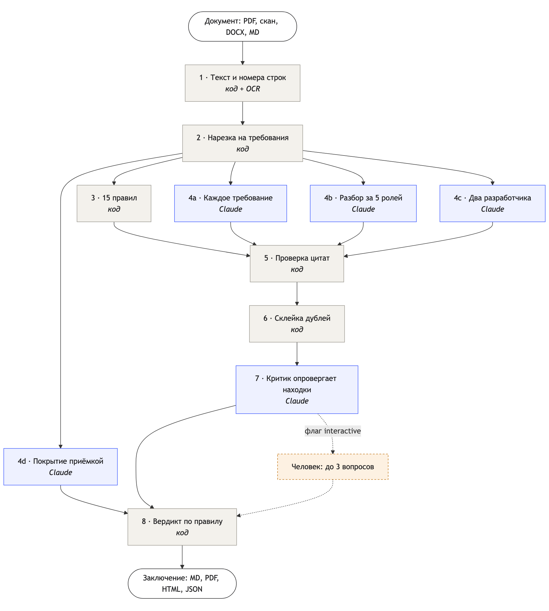
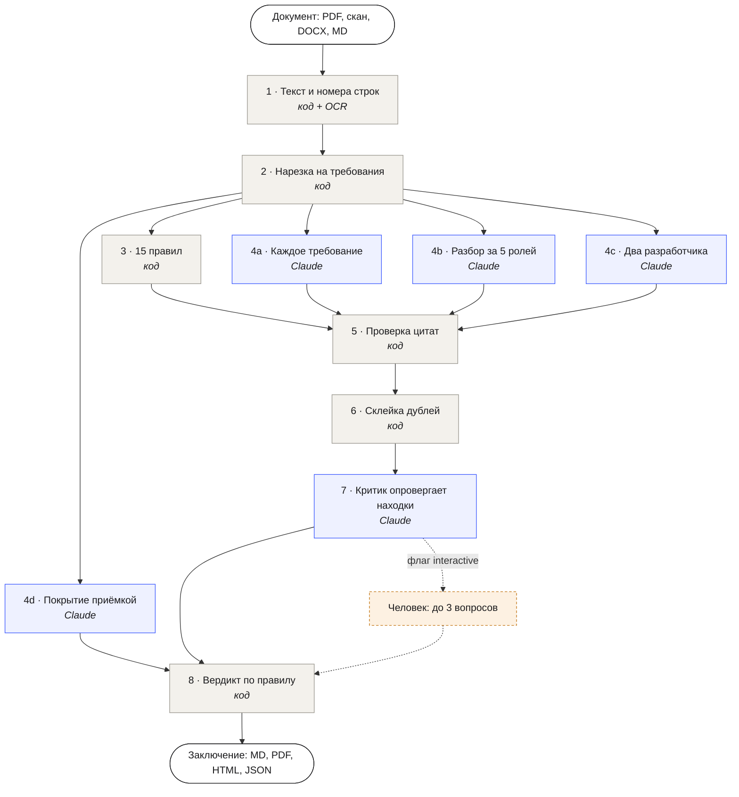

# Материалы для сдачи

| Файл | Что это |
| :--- | :--- |
| `report.md` | **отчёт агента** о проверке выданного документа `docs/requirements.pdf` (основной файл) |
| `report.pdf` | то же заключение в PDF |
| `report.html` | то же заключение для браузера (кнопки скачивания MD / PDF / HTML) |
| `report.json` | трассировка прогона: все находки, решения критика, модели, статусы требований |
| `report.source.txt` | текст документа с номерами строк, на которые ссылается отчёт |
| `from_md/` | та же проверка по Markdown-версии документа (`docs/requirements.md`) |
| `extra/` | заключения по трём настоящим ТЗ из госзакупок РК (русский DOCX, казахские сканы) |

## Архитектура



<details><summary>Тот же граф в Mermaid</summary>



</details>

<sub>Синие блоки — Claude Opus 5.5, серые — детерминированный код, пунктир — необязательный шаг (по умолчанию выключен). Подробнее — в [README](../README.md#архитектура).</sub>

Проверяемый документ — [`../docs/requirements.pdf`](../docs/requirements.pdf) (и `.md`), задание — [`../docs/TASK.md`](../docs/TASK.md).

Воспроизвести:

```bash
python -m reqaudit docs/requirements.pdf submission/report.md --no-cache
```
